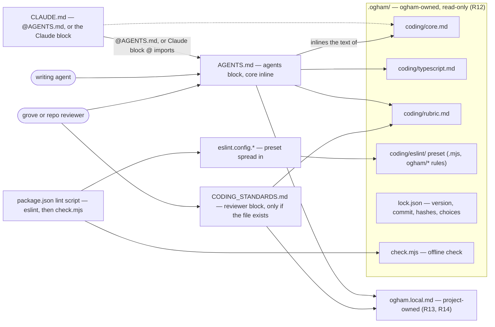
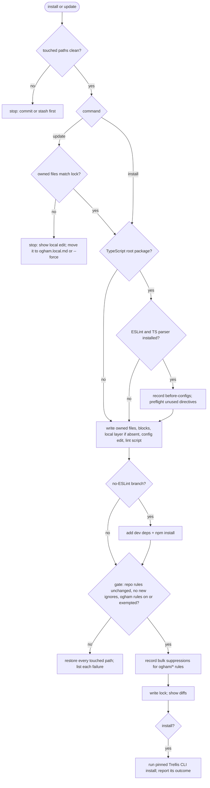

# Ogham, the Coding-Standards Companion - Plan

**Product Contract preservation:** carried from the origin brainstorm plan with no scope change. Planning added only these:
- Outstanding Questions now point at the KTDs that resolve them.
- Sources mark the maintainer's records.
- A "Deferred to Follow-Up Work" subsection under Scope Boundaries holds plan-local deferrals.
- The Ray/Berger assumption notes that U1 verifies it.

**Revised 2026-10-10 for D19 and D20 (Kodhama install model, TRL-107):**
- The CLI's commands are `install | update | check | remove`. `init` is renamed, and `remove` is new.
- Trellis is adopted through Trellis's own CLI instead of ogham's S0–S6 probe (KTD6, U8). U8 waits for that CLI's tag.
- The core is inlined once into `AGENTS.md` instead of reached by a pointer (KTD2, U7).
- Three Product Contract lines changed, with no scope change: R8's "adds pointers" now reads "places the standard"; the staleness deferral names the cross-repo routine; and the Trellis dependency names Trellis's CLI.

**Records outside this repo:** the rulings cited as D1–D20 are in the maintainer's hq records. D1–D13 are in `areas/coding-standards/decisions.md` and D14–D20 in `areas/ogham/decisions.md`. The work item is KOD-5.

---

## Goal Capsule

- **Objective:** in any repo Gonçalo starts or adopts, agent-written code follows his functional-style standard without him reading the code or re-explaining the style.
- **Means:** **ogham**, a sibling product in the Kodhama family that installs a pinned standard, a lint preset and a review rubric through one bootstrap step (KTD1, KTD4).
- **Product authority:** Gonçalo. The Product Contract's R-IDs win on behaviour; a KTD wins on mechanism within them; a unit overrides neither.
- **Stop conditions:**
  - after U1 (research), stop until Gonçalo approves this plan;
  - stop and ask when evidence shows a settled decision (D1–D20) cannot work, or a requirement cannot be met as written. That includes U10's reviewer-pointer and Codex checks;
  - stop at every merge and at the v1 tag: Gonçalo approves both.
- **Execution profile:** one worker, units in dependency order. After U3, the content units (U4) and the tooling units (U5–U9) can run as two streams; whether to staff them as a team is majordomo's call.
- **Who finishes:** the worker opens each PR as a draft and marks it ready when the branch is final; Gonçalo merges and approves the v1 tag.

---

## Product Contract

### Summary

**Ogham** is a sibling to Trellis and grove that carries Gonçalo's coding standard into any repo: pragmatic functional code with data kept apart from behaviour.
One bootstrap step vendors a pinned copy of the standard, installs a lint preset where the language has one, and gives the reviewing agent a rubric to grade against.
Projects may tighten the standard freely and loosen it only by named exemption.

### Problem Frame

Gonçalo rarely reads the code in his personal projects.
Trust has to come from the system: agents that write in a known style, and reviews and linters that check it.
Today only Math Quest has a written coding standard (MQ-384, MQ-331); wisp, trellis and every new repo have none, and his global agent instructions carry no coding style.
No specific failures have been observed — nobody looked — so the companion is preventive: it should set the default before the code base grows, which is when structure starts to matter for agents and humans alike.

### Key Decisions

- **Travels with the repo, not the machine.** Cloud sessions must see what the laptop sees. Governs R9. (session-settled: user-directed — chosen over a machine-local global agents file: keeps cloud parity even though most work is local now)
- **One home for several standards; coding practices first.** Governs R18. (session-settled: user-approved — chosen over shipping organisation in v1, a parallel brainstorm, or parking the others: one shape, grown entry by entry)
- **Explicit per-repo adoption through one bootstrap step.** Governs R7. (session-settled: user-approved — chosen over a machine-wide default and over riding Trellis's adoption: local and cloud stay identical, and the companion isn't tied to a Trellis mechanism he doubts)
- **A sibling product; Trellis stays conduct-only.** (session-settled: user-directed — chosen over a Trellis catalog, a grove component, or a "substrates" layer: standards are not conduct)
- **Named ogham** — the druids' tree alphabet carved on standing stones. (session-settled: user-approved — chosen over graft, heartwood and duir in a themed naming round)
- **Vendored seed kit plus a review rubric; no session-start hook.** Governs R8, R10, R15. (session-settled: user-approved — chosen over plugin injection and gates-first: deterministic, cloud-safe, and reaches reviewers)
- **Tighten freely, loosen only by named exemption.** Governs R12–R14. (session-settled: user-approved — chosen over on/off switches and editing the copy: keeps Math Quest's stricter rules inside the companion and drift visible)
- **Math Quest seeds the core; existing repos adopt one by one.** Governs R5, R17. (session-settled: user-approved — chosen over new-projects-only and keeping Math Quest separate: avoids two conventions side by side)
- **Research informs the rationale, never vetoes.** Governs R6. (session-settled: user-approved — chosen over no research and research-gated rules: evidence that functional style cuts bugs is contested, the design argument is stronger)
- **The companion supplies the rubric; grove or the repo's loop reviews.** Governs R16. (session-settled: user-approved — chosen over the bootstrap installing a reviewer: keeps standards apart from supervision)

### Requirements

**The v1 standard (content)**

- R1. The core states, language-agnostically: pure by default; mutation and side effects explicit, named and isolated in code that does only that; no business logic in effectful code; immutable data by default; functions as first-class values.
- R2. The core keeps data apart from behaviour, in OO languages too: data structures carry no business logic, and behaviour lives in functions or behaviour-only classes that dispatch on their arguments.
- R3. The core is short enough to sit in always-loaded agent context; per-language pages carry detail and examples and are read on demand.
- R4. Every core rule has a stable ID, a rationale, and names its checker (lint, reviewer or structure test).
- R5. Math Quest's general rules (11–16) are the core's source material; whatever is tied to Math Quest's own layout stays in its local layer, so Math Quest loses nothing it requires today.
- R6. Each rule's rationale draws on a bounded, cited research pass that sharpens wording and examples but cannot remove a rule Gonçalo wants.

**Delivery**

- R7. One bootstrap step, runnable by Gonçalo or by an agent, adopts the companion into a repo and makes sure Trellis is adopted too, leaving an existing Trellis adoption as it is.
- R8. The bootstrap vendors a pinned version of the core and the relevant per-language pages, places the standard where both the writing agent and the reviewing agent read it, and installs the lint preset where the repo's language has one.
- R9. An adopted repo behaves the same in a local session and in a cloud session, with no machine-level setup.
- R10. Updating means re-running the bootstrap, which shows the diff of every ogham-owned file and never touches the project's local layer.
- R11. v1 ships a lint preset for TypeScript only; other languages get the prose and the rubric.
- R19. Installing or updating ogham never weakens enforcement a repo already has, including its existing lint settings.

**Adaptation per project**

- R12. The vendored core is read-only inside a project.
- R13. A project-owned local layer may add or tighten rules freely.
- R14. A project loosens a core rule only through a named exemption with a reason that the reviewer can see; a code-level exception is a reasoned disable that names the effect.

**Review**

- R15. The companion ships a review rubric that the reviewing agent grades diffs against, with findings citing rule IDs.
- R16. The companion never runs reviews itself; grove's supervision loop or the repo's own review loop does, and a repo with neither still gets the lint preset where its language has one.

**Existing repos**

- R17. Math Quest adopts first and keeps its project-specific rules as its local layer; wisp follows; trellis takes the core prose and rubric without a lint preset; the markdown-only repos design-system, kodhama and stewards are exempt by name. Each adoption is its own ticket, opened when v1 ships.

**Room for later standards**

- R18. The companion holds more than one standard, so code organisation and architecture can join as later entries without changing how repos adopt it.

### Acceptance Examples

- AE1. **Covers R7, R8, R9.** **Given** a new, empty TypeScript repo, **when** the bootstrap runs, **then** Trellis and the companion are both adopted, and a cloud session opened on that repo reads the same standard and runs the same lint preset with no machine setup.
- AE2. **Covers R14, R15.** **Given** business code that needs a mutating helper, **when** the agent writes it with a named, reasoned exemption, **then** the reviewer accepts it; **when** the exemption is missing or unexplained, **then** the reviewer flags it citing the rule ID.
- AE3. **Covers R10, R13.** **Given** a project with a stricter local rule, **when** the bootstrap re-runs with a newer core, **then** the local rule is untouched and only ogham-owned files change, with their diff shown.
- AE4. **Covers R16.** **Given** a TypeScript repo with no review loop, **when** it adopts the companion, **then** the lint preset enforces the mechanical rules and no reviewer is installed.

### Success Criteria

- A new repo is adopted in one step.
- Agent-written code in an adopted repo passes the lint preset and the rubric without the agent being told about the style.
- Math Quest adopts the companion without losing any rule it enforces today.

### Scope Boundaries

**Deferred for later**

- The code-organisation standard (folders, import structure) and the architecture/repo-structure standard — named next entries per R18.
- Lint presets for Go, Python and other languages.
- Any automatic check that a vendored copy has fallen behind the latest core. Under D19 staleness is advisory only; a cross-repo routine outside ogham runs `update` and opens one PR per repo.

**Outside this product's identity**

- Conduct rules — Trellis's job.
- Running reviews or supervising agents — grove's job.
- Applying itself to every repo on a machine without the repo adopting it.
- Simplifying Trellis's own delivery mechanism — a separate Trellis question.

**Deferred to Follow-Up Work**

- Monorepos: v1 installs the preset for the root package only (KTD13).
- A skill wrapper around the bootstrap; the command alone is v1.
- Listing ogham in the stewards install door; stewards' catalog lists Trellis alone today (kodhama-0030), so listing ogham would supersede that record.
- The type-aware `prefer-readonly-parameter-types` rule as a preset tier; in v1 a project adds it through its local layer.

### Dependencies / Assumptions

- `install` adopts Trellis by calling Trellis's own CLI, `npx github:kodhama/trellis#v<version> install` (D19). TRL-107 builds that CLI; U8 waits for its tag.
- Trellis's cloud path is Claude-only today; Trellis does not yet support Codex (trellis `README.md`, "Local Codex — carried, not supported"). Ogham's own vendored files work on any host; the Trellis half of R9 holds only where Trellis does.
- The rubric only bites where grove or a repo-level review loop runs.
- Gonçalo's thesis — functional style yields more testable, less bug-prone code that agents refactor more easily — is his stated belief. Large-scale evidence that it reduces bugs is contested (Ray et al. 2014; Berger et al. 2019 reproduction — cited from memory, unverified; U1 verifies); the testability argument is the stronger ground.
- No incidents have been observed in repos without the standard; the value is preventive.

<!-- ce-section: work-relationships -->
### How This Work Fits Together

This plan covers the companion's shape and its first standard, coding practices. The breakdown below is the current understanding, not a committed roadmap.

- Code-organisation standard — **Depends on** this plan's delivery shape; **Shares** the bootstrap and the tighten/loosen model. Math Quest's MQ-331 rules 1–10 (naming, folder maps, docblocks, structure test) are likely source material.
- Architecture/repo-structure standard — **Still to decide** whether it is a standard at all or a different kind of guidance.
- Adoption tickets for Math Quest, wisp and trellis — **Depend on** v1 shipping (R17).
- Simplifying Trellis's delivery — **Can proceed independently of** this plan.

### Outstanding Questions

**Resolved in planning** (each answered by the KTD named)

- The bootstrap's form and how it composes with Trellis's installer: KTD4, KTD6.
- How the standard reaches the writing and reviewing agents: KTD2.
- The versioning scheme and pinning: KTD5.
- How the core and per-language pages are split and named: KTD1, KTD3.
- How the preset composes with existing lint without weakening it (R19): KTD7, KTD8.
- What "read-only" means observably (R12): KTD5.
- How a local layer refines a core rule by ID: KTD3, KTD11.
- Which review surfaces receive the rubric: KTD2.
- What the bootstrap does in a repo already on a Trellis delivery state: KTD6.

**Deferred to the adoption tickets**

- Whether machine-skills and minecraft-addons, which hold code, adopt ogham. This is a product call for Gonçalo when the adoption tickets are filed (U10).

### Sources / Research

- Gonçalo's rulings for this plan: hq `areas/coding-standards/decisions.md` (D1–D13) and `areas/ogham/decisions.md` (D14–D20).
- Math Quest functional standard: rules 11–16 in math-quest `docs/code-organisation.md`, enforced by `eslint/pure-by-default.js` and the reviewer; rulings in hq `areas/fp-standard/decisions.md` (D1–D6); PR kodhama/math-quest#883 (MQ-384).
- Math Quest review criteria for its review agent: math-quest `CODING_STANDARDS.md`.
- Trellis adoption and configuration limits: trellis `docs/decisions/` — decision-0077 (silence never adopts; supersedes part of decision-0070), decision-0073 (delivery states are a closed set), 2026-09-15 rule-rows-only (projects can only switch rules off), decision-0068 (no personal-scope rules file).
- Trellis's own framing of rule packs as "substrate, not a process": trellis research-0001.
- Repos in scope: hq `projects/README.md`.

---

## Planning Contract

### Key Technical Decisions

- KTD1. **Everything ogham owns lives under `.ogham/`, namespaced by standard.**
  - `.ogham/coding/` holds the coding standard: the core, the language pages, the rubric and the ESLint preset.
  - Beside it sit `.ogham/lock.json` and `.ogham/check.mjs`, a vendored copy of the `check` command (KTD5).
  - The project's local layer is `ogham.local.md` at the repo root: created once from a template, never touched again.
  - A later standard joins as a sibling folder, so adoption does not change (R18).
- KTD2. **Hook-in is a marked block; the agents block carries the core inline, once** (D20, superseding D15's pointer-only block). Blocks are marked `<!-- ogham:begin -->` and `<!-- ogham:end -->` and come in three variants:
  - **The agents block** carries the core's text inline. It also carries pointers to the language pages, the rubric (reviewers grade diffs against it and cite rule IDs) and `ogham.local.md`, plus an `@` import of `ogham.local.md` so Claude loads the local layer too. Codex can't follow `@` imports and reads only the first 32 KiB of `AGENTS.md`, which is why the core is inline.
  - **The Claude block** carries `@` imports of the core and `ogham.local.md`, plus the same pointers to the language pages and the rubric. It never holds a second inline copy of the core.
  - **The reviewer block** carries the rubric pointer and the `ogham.local.md` pointer only.

  **Placement rules:**
  - The agents block goes into `AGENTS.md`, which Codex reads directly and Claude reads through `CLAUDE.md`'s `@AGENTS.md`.
  - `AGENTS.md` is created when absent.
  - `CLAUDE.md` is created as one `@AGENTS.md` line when absent. When it exists without that import, it gets the Claude block.
  - The reviewer block goes into `CODING_STANDARDS.md` only where that file exists, because ce-code-review treats it as its designated criteria source ahead of `AGENTS.md`. Ogham never creates `CODING_STANDARDS.md`, which would shadow a repo's `AGENTS.md` criteria.

  **Marker handling:** a block sits beside other tools' blocks, never inside one, and duplicated or broken ogham markers stop the run.

  **Size:** `install`, `update` and `check` warn, without failing, when the ogham block's end marker sits past byte 32,768 of `AGENTS.md`, because Codex would not read the rest of the core. The block is appended, so the core sits at the file's tail. `check` repeats the warning after Trellis's block lands. Whether Codex's cap applies per file or across the chain of `AGENTS.md` files is checked at U10.

  **Formatters:** the agents block wraps the inline core in `<!-- prettier-ignore-start -->` and `<!-- prettier-ignore-end -->`, so Prettier leaves it alone. A block-hash mismatch says that a formatter may have caused it, as KTD5 does for owned files.

  **Links:** the core holds no relative links, because it is read inline from the repo root. It names other pages by their repo-root path, such as `.ogham/coding/typescript.md`.

  (session-settled: user-approved, D20. Inlining once follows the Kodhama install model. It was chosen over keeping D15's pointer and over deciding at U10, because a pointer risks Codex never loading the core. A block that changes on update is acceptable when updates arrive as reviewed PRs.)
- KTD3. **Rule IDs are stable slugs: `og-` for the core, `local-` for a project's own rules.** An example is `og-no-hidden-inputs`. An `og-` ID is never reused.
  - Lint messages, rubric findings, exemptions and local tightenings cite the slug.
  - A project-only rule in `ogham.local.md` takes a `local-` ID, unique within that file (R13).
  - Math Quest's bare rule numbers are ambiguous outside their file, so they are not reused.
- KTD4. **The bootstrap is a zero-dependency Node script, run by version tag; writes are applied, verified, then rolled back on refusal.**
  - **Invocation:** `npx github:kodhama/ogham#v<version> <command>`, with four commands: `install`, `update`, `check`, `remove` (D19). It is non-interactive throughout, so a routine can run `update` across repos and open one PR each.
  - **`remove`** undoes what the lock records `install` added. It deletes `.ogham/`, every ogham block, the lines ogham inserted, and the `ogham/*` entries in the bulk-suppressions file, so lint stays green. A file ogham created is deleted only when nothing but ogham's content is left in it. `remove` keeps `ogham.local.md`, leaves Trellis alone, and lists the dev dependencies `install` added without uninstalling them. It uses the same clean-paths refusal and rollback as `install`, and the KTD8 gate confirms the repo's own rules are unchanged. U6 owns the command and its rollback, and U7 and U9 add their own steps to it.
  - **`install` on an adopted repo** (a lock is present) writes nothing. It reports "already adopted", points to `update`, and exits zero.
  - **Clean paths:** it refuses when any path it would touch has uncommitted changes. The one exception is drift in ogham-owned files, which goes to `update`'s tamper check instead (KTD5), so `--force` stays reachable. That precondition is what makes rollback safe. On any refusal after writing, it restores every pre-existing touched path from git, including `package.json` and the lockfile, and deletes every path it created that did not exist before.
  - **Diffs** come from `git diff`.
  - **Runtime:** it uses Node built-ins, git, and the target repo's own ESLint (KTD8).

  (session-settled: user-approved — chosen over a POSIX shell script: JSON merging and hashing need a real runtime)
- KTD5. **Pinning and read-only are enforced by hashes in `.ogham/lock.json`, checked offline by the vendored `check.mjs`.**
  - **The lock records:** the version; the source commit; a sha256 per owned file over LF-normalised content; one hash per placed block (keyed by file); the per-repo choices (languages, preset on or off); and what `install` added outside `.ogham/`, so that `remove` can undo exactly that. That means the files it created, the lines it inserted (config spread, lint-script step, `.prettierignore` entry) and the dev dependencies it added. The lock records nothing about Trellis (KTD6).
  - **`update`** shows the diff of every owned file, and the same tag gives no diff.
  - **A local edit** to an owned file, committed or not, stops `update`, which shows the edit. The way out is to move the change to `ogham.local.md`, or to pass `--force`, which reports what it discards.
  - **`check`** exits non-zero on: a hash mismatch; a missing or altered block; an `og-` reference in `ogham.local.md` that the core does not define; a duplicate `local-` ID; or a disable directive without a reason (KTD7). On a mismatch it also says that a formatter may have caused it.
  - **Formatter:** the bootstrap adds `.ogham/` to `.prettierignore` when that file exists. The agents block guards itself (KTD2).

  The lock model follows the prior art of rulesync's commit-pinned lockfile and ai-rulez's hashed outputs.
- KTD6. **Trellis is adopted by Trellis's own CLI, only on `install`** (D19, superseding D16's Trellis clause and this KTD's earlier S0–S6 probe).
  - **The call:** `install` runs `npx github:kodhama/trellis#v<version> install`, at a Trellis version pinned in ogham's release and recorded in the lock.
  - **Trellis decides:** its CLI is a no-op on any existing Trellis state and on a recorded decline, and it never re-seeds after a `remove` (Trellis requirements R3 and R6, per trl-107-worker). Ogham no longer probes Trellis's states.
  - **Order:** it runs last, after ogham's own writes have verified. Ogham's rollback therefore never has to undo Trellis's files, and Trellis does not refuse over ogham's uncommitted files (Trellis R4).
  - **Outcome:** ogham reports Trellis's one-line outcome. Installed, already present, declined and migrated count as success, and anything else is an error. Plain `install` should never migrate (Trellis R14), but ogham accepts it if reported.
  - **On a Trellis error,** ogham's own adoption stays in place and `install` exits non-zero. It prints the exact `npx github:kodhama/trellis#v<version> install` command to retry once ogham's files are committed. Re-running ogham's `install` cannot retry, because it reports "already adopted".
  - **`update` and `remove` never touch Trellis.** Trellis's own `update` and the cross-repo routine own that.
  - **Cloud:** Trellis's committed files are Trellis's concern. Ogham passes on whatever Trellis's `install` prints.
  - **Not final:** Trellis's exit codes and verb flags are not fixed until its CLI is tagged (TRL-107).

  (session-settled: user-approved, D19, via TRL-107. It reverses D16's rejection of Trellis's installer, because the new CLI is pinnable and non-interactive and owns its own state detection.)
- KTD7. **The TypeScript preset re-registers built-in ESLint rules under an `ogham/` plugin, and checks disable reasons outside ESLint too** (D16).
  - **The rules** are ESLint's own `no-param-reassign`, `no-restricted-properties`, `no-restricted-globals` and `no-restricted-syntax`, taken from `eslint/use-at-your-own-risk` and registered as `ogham/<name>`. They are ported from Math Quest's `eslint/pure-by-default.js` and generalised.
  - **Why distinct IDs:** the repo's own uses of the same built-ins never interact with ogham's. That rules out overriding, shared suppression counts and option collisions (KTD8, KTD9). Verified on ESLint 10.12.0: `ogham/no-restricted-properties` and a repo's `no-restricted-properties` report side by side, each with its own message.
  - **Messages:** the `no-restricted-*` messages cite `og-` IDs. `no-param-reassign` keeps ESLint's fixed message, and the TypeScript page maps each `ogham/*` rule to its `og-` ID.
  - **Scope:** source files in JS and TS extensions, tests excluded, as Math Quest's globs do.
  - **Format:** the preset is vendored as `.mjs`, so it loads whatever the repo's module type.
  - **Disable reasons:** an inline rule, `ogham/disable-needs-reason`, reports a disable directive without a `-- reason` for editor feedback. A blanket `eslint-disable` would silence that rule, so the same check also runs in `check.mjs`, which scans comments directly and is wired into the repo's lint script (KTD10).
  - **Unused directives:** `linterOptions.reportUnusedDisableDirectives` is set to error.

  (session-settled: user-approved — chosen over eslint-plugin-functional 10.0.1: its useful rules need typed linting, Math Quest's fp-standard proposal declined it, and built-ins cover the measured gaps)
- KTD8. **R19 is a hard gate over the repo's own rules, compared before and after on every lint target.**
  - **Lint targets** are the tracked files that ESLint, run from the repo root with its default config lookup, would lint and not ignore. A lint script that passes an alternate config path stops the run with instructions.
  - **The comparison:** `ESLint#calculateConfigForFile` runs for every target, before and after. The gate refuses when a non-`ogham/` rule disappears, is turned off, drops in severity or changes options, or when a file becomes newly ignored. Rule options have no general strictness ordering, so any change counts.
  - **Ogham's own rules** are excluded from the comparison: their changes are versioned and appear in the update diff.
  - **A second pass** reports any `ogham/*` rule that a repo block turns off without a matching exemption (KTD11).
  - **Dependencies:** the gate runs against the repo's installed dependencies. When they are absent it stops and says so, except on the no-ESLint branch (KTD10).
- KTD9. **Day one stays green without hiding anything the repo already enforces.**
  - **A preflight** lists any existing unused disable directive and stops, because those cannot be suppressed.
  - **Bulk suppressions:** existing violations of `ogham/*` rules become ESLint bulk suppressions, the pattern Math Quest's fp-standard D6 chose. They are keyed to `ogham/*` IDs only, so suppression capacity can never cover a repo rule. The suppressions file can only shrink.
- KTD10. **The bootstrap makes sure lint runs; the repo's own CI decides when.**
  - **The lint script:** the bootstrap adds a `lint` script when there is none, and appends `node .ogham/check.mjs` to it when it is a plain command. Any other script shape is reported with the line to add.
  - **No ESLint:** it adds `eslint` and `typescript-eslint` as dev dependencies with the repo's package manager, installs them inside the rollback scope, and writes a minimal config: `eslint.config.mjs` unless the repo is `"type": "module"`. With no prior lint config there is nothing to weaken, so the comparison is skipped.
  - **ESLint but no TypeScript parser:** it adds and installs `typescript-eslint` only, inside the rollback scope. It then takes the normal path: the preset goes into the existing config, and the KTD8 gate compares the repo's effective config before and after. The repo's existing config is never replaced.
  - **No CI step runs lint:** it reports that and does not edit CI.
- KTD11. **Exemptions live in `ogham.local.md` and pair with lint where lint is involved.**
  - **An exemption entry** names the `og-` ID, its scope and the reason.
  - **A code-level exception** is `eslint-disable-next-line ogham/<rule> -- og-<id>: <effect>`.
  - **A folder-wide loosening** is a block in the repo's own config that turns an `ogham/*` rule off for a glob, plus a matching exemption entry. KTD8's second pass accepts it only with that entry.
  - **A local tightening** narrows a core rule by citing its `og-` ID, or adds a rule with a `local-` ID.
- KTD12. **The research pass is bounded and source-first** (D16, D8). For each principle:
  - **Leads:** Gemini enumerates candidate sources as domain, URL and verbatim quote, with no synthesis. The worker reads each source and quotes it.
  - **Check:** Codex Sol checks the citations and looks for counter-evidence.
  - **Budget:** at most six sources considered and two to four cited per principle.
  - **Result:** findings may change a rule's wording or examples; contested evidence is recorded as contested; no rule is removed (R6).
- KTD13. **The preset installs only where the root has TypeScript and a `package.json`.** TypeScript is detected from a `tsconfig.json` or tracked `.ts` files, so a JS repo with a `tsconfig.json` for `checkJs` (ogham itself) counts. A JS-only, Go or Python repo gets the prose and the rubric. The choice is recorded in the lock, so `update` never flips it. Monorepos lint only the root package in v1.
- KTD14. **Ogham dogfoods itself.** Its code is plain ESM JavaScript checked by `tsc` with `checkJs`, tested with `node:test`, and linted by its own preset, whose globs cover `.js` and `.mjs`. The dev dependencies (typescript, eslint, typescript-eslint) are recorded in `docs/decisions/dependency-adoption.md`; the shipped scripts have none.

### High-Level Technical Design

**What an adopted repo looks like, and what points where.**



**What `install` and `update` do.** `check` runs the same verifications read-only, and so does `check.mjs`, offline. `remove` is not drawn.



An unrecognised lint-config shape changes one step. `apply` vendors everything except the config edit and saves the before-configs as a pending baseline. The run then prints the exact lines to add. The next `install` or `update` detects the added import and finishes the gate against that baseline.

### Output Structure

```text
.
├── bin/ogham.mjs                     # entry: install | update | check | remove
├── src/                              # bootstrap modules (pure core, thin IO shell)
├── standard/coding/
│   ├── core.md
│   ├── typescript.md
│   ├── rubric.md
│   └── eslint/                       # preset + disable-needs-reason rule (.mjs)
├── templates/                        # ogham.local.md, the three block variants, CLAUDE.md seed
├── test/                             # node:test units + fixture repos
│   ├── fixtures/
│   └── acceptance/
├── docs/
│   ├── plans/
│   ├── research/
│   ├── decisions/
│   └── mq-rule-mapping.md
└── .github/workflows/test.yml
```

### Assumptions

- Machines and cloud sessions that run the bootstrap have Node 20 or later, git, and network access to GitHub (KTD4). A cloud environment with a network allowlist that blocks GitHub cannot run `install`; the repo, once adopted, needs nothing, since `check.mjs` is vendored.
- The repo's ESLint version supports bulk suppressions (KTD9). U9 confirms the version floor and stops with a clear message below it.
- Claude Code resolves the `@` import of `ogham.local.md` inside `AGENTS.md` when `CLAUDE.md` imports `AGENTS.md` (KTD2). U10 checks it in a real session.

### Risks & Dependencies

| Risk | Mitigation |
|---|---|
| `eslint/use-at-your-own-risk` is not a stable API, and a release could drop `builtinRules` | A U5 test fails loudly if the export or any aliased rule is missing. The fallback is to copy those four rules' sources, which are MIT-licensed, into the preset |
| ce-code-review's standards reviewer may not follow a pointer from `CODING_STANDARDS.md` to the rubric | U10 runs a real ce-code-review for AE2. If the reviewer does not follow the pointer, stop and bring the evidence to Gonçalo. D20 inlines only the core, so inlining the rubric is his call |
| `AGENTS.md` grows past Codex's 32 KiB read limit, so Codex misses part of the inline core (R3) | The core keeps to 900 words (U3), and Trellis's block is about 7 KB (trl-107-worker). `install`, `update` and `check` warn past 32 KiB (KTD2). U10 tests a Codex session |
| Trellis's cloud reach depends on Trellis's CLI | The Product Contract already bounds this ("the Trellis half of R9 holds only where Trellis does"). Ogham passes on what Trellis's `install` prints, and U10's cloud check covers ogham's half |
| Trellis's CLI does not exist yet, and its exit codes and flags are not final (TRL-107) | U8 runs after U9, as the last unit before U10. If the CLI is not tagged when U9 merges, stop and ask Gonçalo whether to wait or ship v0.1.0 without the Trellis half. Shipping without it would defer part of R7 and AE1, which needs his ruling |
| Math Quest has a known review gap: its `CODING_STANDARDS.md` likely hides rules 11–16 from ce-code-review (inferred from the reviewer's instructions, not observed) | The Math Quest adoption ticket (U10) carries it, and the reviewer block in `CODING_STANDARDS.md` closes it on adoption |

---

## Implementation Units

| U-ID | Title | Key files | Depends on |
|---|---|---|---|
| U1 | Research pass: cited rationale per principle | `docs/research/` | — |
| U2 | Repo foundations: tooling, CI, decisions | `package.json`, `.github/workflows/test.yml`, `docs/decisions/` | — |
| U3 | Core standard, TypeScript page, Math Quest mapping | `standard/coding/core.md`, `typescript.md`, `docs/mq-rule-mapping.md` | U1, U2 |
| U4 | Review rubric | `standard/coding/rubric.md` | U3 |
| U5 | TypeScript lint preset | `standard/coding/eslint/` | U3 |
| U6 | Bootstrap: vendoring, lock, update, check | `bin/ogham.mjs`, `src/` | U2, U3 |
| U7 | Bootstrap: hook-in blocks and local layer | `src/`, `templates/` | U3, U6 |
| U8 | Bootstrap: Trellis half | `src/` | U6, U9 (sequencing); Trellis CLI tag (TRL-107) |
| U9 | Bootstrap: lint wiring, never-weaken gate, suppressions | `src/` | U5, U6 |
| U10 | Acceptance run, release and follow-up tickets | `test/acceptance/`, `README.md` | U4, U7, U8, U9 |

### U1. Research pass: cited rationale per principle

**Goal:** give each principle in R1 and R2 a cited rationale, and record what is known about how agents handle code written this way.

**Requirements:** R6, R4 (the rationale part); D8.

**Dependencies:** none.

**Files:**
- `docs/research/2026-10-08-principle-rationale.md`

**Approach:**
1. List the principles from R1 and R2, plus the Math Quest rules they absorb (11–16).
2. Run the KTD12 method per principle.
3. Run one more KTD12-bounded question: what evidence exists on how coding agents handle pure, effect-isolated code (testability, refactoring, error rates).
4. Verify the two citations the Product Contract carries from memory (Ray et al. 2014; Berger et al. 2019) and correct them if wrong.
5. Write one section per principle and one for the agents question. Each section gives the claim, sources with quotes, strength (supported, contested or design argument only), and the wording or example changes it suggests.

**Patterns to follow:** the multi-model rules on search versus synthesis. Gemini finds sources; it does not conclude.

**Test expectation:** none -- a research document; its gate is the citation check in Verification.

**Verification:**
- Every principle and the agents question has at least two cited sources with verbatim quotes, or an explicit "no source found".
- Codex Sol's citation check is attached to the PR, with each finding triaged.
- No rule is removed; contested evidence is labelled as contested.
- Work stops here until Gonçalo approves this plan.

### U2. Repo foundations: tooling, CI, decisions

**Goal:** make the repo able to test, typecheck and lint its own code, and gate `main`.

**Requirements:** KTD14; supports every later unit.

**Dependencies:** none.

**Files:**
- `package.json`, `package-lock.json`, `tsconfig.json`
- `.github/workflows/test.yml`
- `docs/decisions/dependency-adoption.md`
- `test/smoke.test.js`

**Approach:**
1. Add the dev dependencies KTD14 names, each recorded in the decision file.
2. Add `test`, `typecheck` and `lint` scripts. Lint starts as plain ESLint and switches to ogham's own preset in U5.
3. Add a CI job that runs typecheck, tests and gitleaks, mirroring grove's `test.yml`.
4. Ask Gonçalo to apply `main` protection like grove's ruleset once the job has reported; the worker does not change repo settings itself.

**Patterns to follow:** grove's `.github/workflows/test.yml`, `.gitleaks.toml` and `docs/decisions/dependency-adoption.md`.

**Test scenarios:**
- A smoke test runs under `node --test` and passes, proving the runner is wired.

**Verification:** CI is green on the PR; typecheck passes with `checkJs`.

### U3. Core standard, TypeScript page, Math Quest mapping

**Goal:** write the always-loaded core and the TypeScript page, and show that Math Quest loses nothing.

**Requirements:** R1, R2, R3, R4, R5, R6; KTD3.

**Dependencies:** U1, U2.

**Files:**
- `standard/coding/core.md`
- `standard/coding/typescript.md`
- `docs/mq-rule-mapping.md`
- `test/standard-structure.test.js`

**Approach:**
1. Write one entry per rule. Each entry carries its `og-` ID, a one-line rule, a short rationale citing U1's sources, and its checker (lint, reviewer or structure test).
2. Cover R1's five principles and R2's data/behaviour split. Absorb Math Quest rules 11–16: return new values, local building is fine, no hidden inputs, no module-level state, thin effects, and the four effect markers.
3. Keep paths, interface names and other Math Quest specifics out of the core. They go in the mapping as Math Quest's local layer.
4. Put language detail and examples in the TypeScript page: `readonly` as the type marker, the `Effect:`/`Mutates:` docblock line, disables that name the effect, and the table mapping each `ogham/*` lint rule to its `og-` ID.
5. Set a size budget for the core, at most 900 words, so it fits in always-loaded context (R3). It is inlined into `AGENTS.md` (D20) beside Trellis's block of about 7 KB, all within the 32 KiB Codex reads.

**Patterns to follow:** math-quest `docs/code-organisation.md` rules 11–16, with each rule's "Checked by" column as the checker.

**Test scenarios:**
- Every rule in `core.md` has an `og-` ID, a rationale line and a checker from {lint, reviewer, structure test}; a rule missing any of these fails.
- `og-` IDs are unique.
- `core.md` stays within its word budget.
- Every Math Quest rule 11–16 maps to an `og-` ID or to Math Quest's local layer in `docs/mq-rule-mapping.md`; a missing rule fails.
- `core.md` contains no repo path (any token shaped like `src/…`) and no Math Quest identifier.
- `core.md` contains no relative Markdown link. Other pages are named by repo-root path (`.ogham/coding/…`), since the core is read inline (KTD2).

**Verification:** the structure test passes, and Gonçalo reads the core in the PR. The core is his taste, and R6 gives research no veto.

### U4. Review rubric

**Goal:** give reviewers a rubric to grade diffs against, citing rule IDs.

**Requirements:** R15, R14, R16; KTD3, KTD11.

**Dependencies:** U3.

**Files:**
- `standard/coding/rubric.md`
- `test/rubric.test.js`

**Approach:**
1. List one check per core rule, phrased as what to look for in a diff, plus how lint already covers it where it does.
2. Add exemption checks: a loosening needs an entry in `ogham.local.md` with a reason, and a disable comment needs a reason naming the effect.
3. Tell the reviewer to apply the project's `local-` rules and tightenings from `ogham.local.md` too.
4. Fix a finding format: rule ID, location, evidence, and whether an exemption covers it.
5. State that the rubric is criteria for the repo's reviewer; ogham runs no review (R16).

**Test scenarios:**
- Every core `og-` ID appears in the rubric, and the rubric cites no unknown ID.
- The rubric names the finding format with a rule-ID field.

**Verification:** both tests pass. U10 exercises the rubric in a real review (AE2).

### U5. TypeScript lint preset

**Goal:** ship a preset that enforces the mechanical rules under `ogham/*` IDs, plus the disable-reason checks.

**Requirements:** R11, R14, R16, R19; KTD7, KTD11.

**Dependencies:** U3.

**Files:**
- `standard/coding/eslint/index.mjs`
- `standard/coding/eslint/disable-needs-reason.mjs`
- `src/scan-disables.mjs` (shared with `check.mjs`)
- `test/eslint-preset.test.js`, `test/scan-disables.test.js`
- `test/fixtures/lint/`

**Approach:**
1. Register the four built-ins under the `ogham` plugin, port Math Quest's options, and generalise the scope globs to JS and TS source extensions, excluding tests.
2. Write `disable-needs-reason` as an inline plugin rule.
3. Write the comment scanner that `check.mjs` runs.
4. Make each `no-restricted-*` message cite its `og-` ID.
5. Switch ogham's own lint script to the preset.

**Patterns to follow:** math-quest `eslint/pure-by-default.js` and `test/lint-pure-by-default.test.ts`, which runs the rules through `Linter` and checks the real config's wiring.

**Test scenarios:**
- Assigning to a parameter's property is reported as `ogham/no-param-reassign`.
- `Date.now()`, `Math.random()`, `process.env` and `new Date()` with no arguments are each reported under `ogham/*` with a message citing the matching `og-` ID. `new Date(x)` is not reported.
- A top-level `let` or `var` is reported; a `let` inside a function is not.
- Pushing into an array the function just created raises no lint error; the rubric covers that judgment.
- A repo block setting its own `no-restricted-syntax` after the preset leaves every `ogham/no-restricted-syntax` report intact, and its own reports stay separate.
- `eslint-disable-next-line ogham/no-param-reassign` with no `--` reason is reported by `disable-needs-reason`. The same line with `-- og-…: mutates the caller's buffer` is accepted.
- A blanket `/* eslint-disable */` with no reason is caught by the scanner even though it silences the ESLint rule. A disable naming `ogham/disable-needs-reason` itself is caught too.
- An unused disable directive is an error.
- A `.js` file and a `.ts` file on source paths are both checked; a file under a test glob is not.
- If `eslint/use-at-your-own-risk` no longer exports any of the four rules, a test fails naming it.

**Verification:** preset and scanner tests pass, and ogham's own code lints clean with its preset.

### U6. Bootstrap: vendoring, lock, update, check

**Goal:** `install`, `update` and `check` vendor the pinned standard, record and verify it, and show diffs; `check.mjs` runs the same checks offline; `remove` takes ogham's owned files back out.

**Requirements:** R7 (ogham half), R8, R10, R12; KTD1, KTD4, KTD5, KTD13.

**Dependencies:** U2, U3.

**Files:**
- `bin/ogham.mjs`
- `src/vendor.mjs`, `src/lock.mjs`, `src/detect.mjs`, `src/check.mjs`, `src/apply.mjs`
- `test/vendor.test.js`, `test/lock.test.js`, `test/check.test.js`, `test/apply.test.js`
- `test/fixtures/repos/`

**Approach:**
1. Keep decisions pure (what to write, what changed, what fails) and keep filesystem and git access in a thin shell, the standard ogham ships.
2. Resolve the source by tag, and record the commit.
3. Hash LF-normalised content.
4. Apply, verify, and roll back from git on refusal (KTD4).
5. Vendor `src/check.mjs` as `.ogham/check.mjs`.
6. Add the `.prettierignore` entry and record the language choice (KTD5, KTD13).

**Execution note:** test-first; build each pure decision function before its shell.

**Test scenarios:**
- `install` on an empty repo writes `.ogham/coding/*`, `check.mjs` and `lock.json`, and hashes in the lock match the files.
- `update` to the same tag reports no diff and writes nothing.
- `update` to a newer tag shows a diff for each changed owned file and leaves `ogham.local.md` byte-identical. Covers AE3.
- `update` when an owned file was edited locally stops and shows that edit, whether or not the edit was committed. The clean-path check does not block this case. With `--force` it overwrites and reports what it discarded.
- A refusal after writing during a first `install` deletes the files it created (`.ogham/`, `ogham.local.md`, a new `AGENTS.md` or `CLAUDE.md`), leaving `git status` clean.
- `check` and `.ogham/check.mjs` both exit zero on a clean adoption. Both exit non-zero on an edited owned file, and on a lock whose commit does not match its tag.
- `install` when a path it would touch has uncommitted changes refuses and writes nothing.
- `remove` deletes `.ogham/` (lock and `check.mjs` included), keeps `ogham.local.md` byte-identical, touches only the paths the lock lists, and refuses on uncommitted changes as `install` does. A failure partway restores every touched path.
- `install` on a repo that has a lock writes nothing, reports "already adopted", and exits zero.
- The lock lists every file `install` created and every line it inserted outside `.ogham/`.
- No command prompts. Each one completes or refuses with a non-zero exit when stdin is closed.
- A refusal after writing restores every touched path, leaving `git status` clean.
- A file that differs only in CRLF line endings is not reported as a local edit.
- A Go-only repo gets the prose and the rubric with no preset, and `update` does not add the preset later.

**Verification:** all tests pass on fixture repos built in a temporary directory.

### U7. Bootstrap: hook-in blocks and local layer

**Goal:** place the three block variants where the writing and reviewing agents read, with the core inline once in `AGENTS.md`, and seed the local layer.

**Requirements:** R3, R8 (hook-in), R12, R13, R14, R16; KTD2, KTD3, KTD11.

**Dependencies:** U3, U6.

**Files:**
- `src/blocks.mjs`
- `templates/block-agents.md`, `templates/block-claude.md`, `templates/block-reviewer.md`, `templates/ogham.local.md`, `templates/CLAUDE.md`
- `test/blocks.test.js`

**Approach:**
1. Follow the KTD2 placement rules.
2. Seed `ogham.local.md` with empty Tightenings, Local rules and Exemptions sections that explain the KTD3 and KTD11 formats.
3. Record one hash per placed block in the lock.

**Test scenarios:**
- A repo with no `AGENTS.md` or `CLAUDE.md` gets both: `CLAUDE.md` is one `@AGENTS.md` line, and `AGENTS.md` holds the agents block with the core's text inline, byte-identical to the vendored `core.md`.
- A repo with `CLAUDE.md` but no `AGENTS.md` gets a new `AGENTS.md` with the agents block. When `CLAUDE.md` lacks the import, it gets the Claude block (`@` imports only), so the core's text appears once across both files.
- `update` to a core that changed rewrites the inline text inside the block, and the diff shows it.
- An `AGENTS.md` whose ogham end marker sits past byte 32,768 gets a warning naming the offset, and the run still succeeds. A large file with the block ending inside the limit gets no warning.
- The inline core sits inside `prettier-ignore-start`/`end`, and running Prettier on `AGENTS.md` leaves the block hash unchanged.
- When `CLAUDE.md` gets the Claude block, the block carries the rubric and language-page pointers too.
- `remove` deletes every ogham block and leaves the rest of each file byte-identical. It deletes a `CLAUDE.md` or `AGENTS.md` only when ogham created the file and the block was all it held.
- A repo whose `AGENTS.md` has content gets the block appended. A re-run does not duplicate it, and the rest of the file is byte-identical.
- A repo with `CODING_STANDARDS.md` gets the reviewer block there. A repo without one does not get the file created.
- An `AGENTS.md` holding a `trellis:begin` block keeps it intact, with ogham's block placed after it, never inside.
- Two ogham begin markers, or a begin without an end, stop the run with the file and line numbers.
- An existing `ogham.local.md` is never rewritten by `install`, `update` or `remove`.
- `check` fails when any placed block was deleted or its text edited, naming the file.
- `check` fails on an `og-` reference the core lacks and on a duplicate `local-` ID; a unique `local-` rule passes.

**Verification:** tests pass. U10 checks a real Claude session for the `@` import (Assumptions).

### U8. Bootstrap: Trellis half

**Goal:** `install` makes sure Trellis is adopted by calling Trellis's own CLI, pinned, and reports what it did.

**Requirements:** R7, R9 (Trellis half); KTD6.

**Dependencies:** U6, plus a tagged Trellis CLI from TRL-107. Sequenced after U9, as the last unit before U10 (Risks).

**Files:**
- `src/trellis.mjs`
- `test/trellis.test.js`

**Approach:**
1. Keep the pinned Trellis version in one constant in ogham's source, and record it in the lock.
2. Build outcome parsing as a pure function over Trellis's exit code and stdout line, using the codes Trellis publishes with its tag.
3. The shell runs `npx github:kodhama/trellis#v<version> install` after ogham's own writes verify.
4. Before building, confirm the exit codes and flags with trl-107-worker or Trellis's README at the tag.

**Test scenarios:**
- `install` calls Trellis's CLI with the pinned version, once, after the lock is written. A stubbed CLI records the call.
- Each Trellis outcome (installed, already present, declined, migrated, error) is reported in one line. The first four count as success. An unknown exit code is reported as an error, never as success.
- A Trellis error leaves ogham's adoption in place. `install` exits non-zero, names Trellis, and prints the exact Trellis command to retry.
- The lock holds no Trellis data.
- `update` and `remove` never call Trellis's CLI.
- With a real tagged Trellis CLI: an empty repo ends adopted. A repo where Trellis was removed or declined stays that way.

**Verification:** tests pass with a stubbed CLI. One run against the real tagged CLI on a fixture repo is recorded in the PR.

### U9. Bootstrap: lint wiring, never-weaken gate, suppressions

**Goal:** install the preset into a TypeScript repo without weakening anything, and keep lint green on day one.

**Requirements:** R8 (preset), R11, R16, R19; KTD7, KTD8, KTD9, KTD10, KTD11.

**Dependencies:** U5, U6.

**Files:**
- `src/lint-wiring.mjs`, `src/weaken-gate.mjs`, `src/suppressions.mjs`
- `test/weaken-gate.test.js`, `test/lint-wiring.test.js`
- `test/fixtures/repos/ts-*`

**Approach:**
1. Insert the preset import and spread into a recognised flat-config export: a plain array, `defineConfig(...)` or `tseslint.config(...)`.
2. For an unrecognised shape, take the pending-baseline path described under the second diagram.
3. Run the KTD8 gate and the KTD9 preflight and suppressions using the repo's own ESLint.
4. Run the KTD10 install branch inside the rollback scope.
5. Confirm the ESLint version floor for bulk suppressions; below it, stop with a clear message.

**Execution note:** test-first on the gate's comparison function, since it carries R19.

**Test scenarios:**
- A repo with `no-param-reassign` set to error with options: after install, its effective config for the same file is unchanged. Covers R19.
- A candidate config that drops a repo rule's severity from error to warn makes the gate refuse, names the rule and a file, and rolls back.
- A candidate that changes a repo rule's options in any way is refused.
- A candidate that newly ignores a file is refused.
- An `update` whose new preset adds one `ogham/no-restricted-properties` entry passes the gate and shows the change in the diff.
- A repo block that turns `ogham/no-restricted-syntax` off for a folder fails the second pass, and passes once `ogham.local.md` has a matching exemption.
- A repo with existing `Date.now()` calls in source lints green after install. The suppressions file lists those counts under `ogham/no-restricted-properties` alone, and a new repo-rule violation is not absorbed by them.
- A repo with an existing unused disable directive stops at the preflight, listing it, and writes nothing.
- A repo with no ESLint (wisp's shape) gets ESLint, typescript-eslint, a minimal config and a `lint` script ending in `check.mjs`. Covers AE4.
- A repo with ESLint and a config but no TypeScript parser gets `typescript-eslint` added and keeps its config. The gate compares its effective config before and after, and dropping one of its JavaScript rules is refused.
- A `"type": "commonjs"` repo gets `eslint.config.mjs`, and the `.mjs` preset loads.
- A repo with no installed dependencies, outside the no-ESLint branch, stops before the gate with an instruction to install them.
- A config wrapped in a function (Math Quest's `withKnowledgeBoundary([...])` shape) gets everything except the config edit, plus a pending baseline. After the import is added by hand, the next run completes the gate against that baseline.
- A lint script passing `--config other.js` stops with instructions.
- Re-running `update` does not insert the preset twice.
- `remove` takes the preset spread, the `check.mjs` step and the `ogham/*` bulk-suppression entries back out. The lint config and the `lint` script then match their pre-install contents in the fixture's git history, and lint passes with no unused-suppression error. A minimal config or `lint` script that `install` created (the no-ESLint branch) is deleted only if the repo has not changed it since. `remove` lists the dev dependencies `install` added, and leaves them installed.

**Verification:** tests pass on fixture repos with real ESLint installed.

### U10. Acceptance run, release and follow-up tickets

**Goal:** prove AE1–AE4 and the Success Criteria end to end, ship v0.1.0 on approval, and file the work v1 hands on.

**Requirements:** AE1–AE4, R9, R17, R18; Success Criteria.

**Dependencies:** U4, U7, U8, U9.

**Files:**
- `test/acceptance/adoption.test.js`
- `README.md`

**Approach:**
1. Write automated acceptance tests on fixture repos (AE1 local half, AE3, AE4). AE1's "new, empty TypeScript repo" fixture is a `package.json` and a `tsconfig.json` with no code and no installed dependencies.
2. Run the manual checks and record their evidence in the PR:
   - **AE1, cloud half:** open a cloud session on an adopted fixture repo; it reads ogham's core and lint runs. Trellis's cloud reach follows Trellis's CLI and is noted separately (Risks).
   - **AE2:** one ce-code-review run on a fixture diff, with and without an exemption.
   - **The `@` import:** it resolves in Claude Code.
   - **Codex:** a Codex session sees the inline core. Asked to write code, it follows the core. Also record whether Codex's 32 KiB cap applies per `AGENTS.md` file or across the chain (KTD2). If it does not follow the core, stop and bring the evidence to Gonçalo.
   - **The agent-trial for the Success Criteria:** a fresh Claude session in an adopted fixture writes a small feature with no style prompt, then lint and one rubric review run on its diff.
3. Have ogham adopt itself.
4. Update the README with install and update instructions.
5. After Gonçalo approves, tag v0.1.0.
6. File the follow-up tickets in Linear, then update KOD-5:
   - adoption tickets for Math Quest, wisp and trellis (R17). Math Quest's carries the review-gap finding and the replacement of its `pure-by-default` with ogham's preset;
   - the machine-skills and minecraft-addons question;
   - issues for the code-organisation and architecture entries (R18, D2), each linked from KOD-5.

**Test scenarios:**
- Covers AE1. The fixture, after `install`, has Trellis adopted, the agents block, `.ogham/`, installed lint dependencies and a `lint` script. `check` passes, and lint flags a seeded `Math.random()` in source, citing its `og-` ID.
- Covers AE3. A fixture repo with a local tightening, after `update` to a newer fixture tag, shows diffs only for `.ogham/` files and blocks, and keeps `ogham.local.md` unchanged.
- Covers AE4. A TypeScript fixture with no review loop gets the preset enforcing on lint, and no review skill or agent is installed.
- Covers AE2 (manual). A real reviewer run on a diff with a mutating helper flags it citing its `og-` ID. With a named exemption in `ogham.local.md`, the reviewer accepts it.

**Verification:**
- The automated acceptance tests pass.
- Each manual check has its evidence in the PR, or a stop raised to Gonçalo when one fails.
- The agent-trial's diff passes lint, and its review returns no unexempted finding; otherwise the gap goes to Gonçalo before the tag.
- The tickets are filed and linked from KOD-5.

---

## Verification Contract

- **Gates on every PR:** `npm run typecheck`, `npm test` (all `node:test` suites, including fixture repos) and `npm run lint` (ogham's own preset, from U5, then `check.mjs`), with gitleaks in CI. All must be green; a red is fixed, never merged past.
- **Review:** every PR gets an in-session review before it opens, at least `/code-review`, and `ce-code-review` for U5–U9. Plans and the research document get `ce-doc-review`. The author never rules its own work correct.
- **Acceptance:** `test/acceptance/` proves AE1 (local), AE3 and AE4. AE1's cloud half, AE2, the import check, the Codex check and the agent-trial are manual, with their evidence recorded in U10's PR.
- **Research:** U1's citations are checked by Codex Sol, and each finding is triaged against its source.

## Definition of Done

- U1–U10 are merged by Gonçalo, and v0.1.0 is tagged with his approval.
- Every Product Contract requirement is met. A requirement may be deferred only when it is already listed under Scope Boundaries or Gonçalo approves the deferral in writing.
- `npx github:kodhama/ogham#v0.1.0 install` adopts AE1's fixture in one step, and the agent-trial passes lint and the rubric.
- `main` protection is in place, confirmed through the GitHub API.
- The adoption tickets (R17) and the next-entry issues (R18) are filed and linked from KOD-5.
- No dead code from abandoned approaches remains in the diff, and no decision was made without a record under `docs/decisions/` or the maintainer's rulings.
